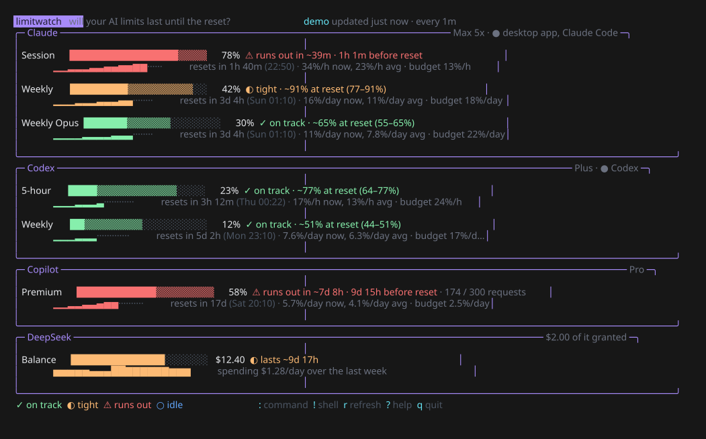

<div align="center">

# limitwatch

**Will your AI plan limits last until the reset?**
See your Claude and ChatGPT (Codex) usage limits in the terminal, and get a forecast, based on how fast you're using them, of whether you'll run out before they reset.

[](https://github.com/ItsFurai/LimitWatch/actions/workflows/ci.yml)
[](https://github.com/ItsFurai/LimitWatch/releases/latest)
[](go.mod)
[](LICENSE)



[Install](#install) · [Usage](#usage) · [Reading the dashboard](#reading-the-dashboard) · [Commands](#commands) · [How the forecast works](#how-the-forecast-works) · [Where the numbers come from](#where-the-numbers-come-from) · [Contributing](CONTRIBUTING.md) · [Changelog](CHANGELOG.md)

</div>

## Features

- **Every limit in one place.** Claude's 5-hour session and weekly limits (including per-model ones like Weekly Opus), and ChatGPT's Codex windows, side by side.
- **A forecast, not just a percentage.** For each limit you get a verdict, *on track*, *tight* or *runs out in ~40m*, plus how much will be left at the reset.
- **Knows your pace.** It compares your average pace since the window started with your pace over the last stretch, and shows the range between them.
- **Tells you how to make it.** A *budget* pace for each limit: stay under it and you'll last until the reset.
- **Live dashboard.** Refreshes every minute, with a timeline of how each window has gone so far, and right away when Claude Code refreshes its sign-in or Codex logs a new message.
- **Knows what's running.** Shows which Claude and ChatGPT apps are open, and when a limit can't be read, tells you exactly what to do about it.
- **A command bar.** Switch providers, change the refresh rate, sign in again or run any shell command without leaving the dashboard.
- **Scriptable.** `limitwatch status --json` for scripts, and `limitwatch statusline` for a shell prompt or Claude Code's status line.
- **Nothing to configure.** It reads the sign-ins Claude Code and Codex already have. It never stores, refreshes or sends your tokens anywhere except the provider's own API.
- **One small binary.** About 8 MB, no runtime or C dependencies, for Windows, macOS and Linux on x86-64 and ARM64.

## Install

### Download a release

Get a build for your system from the [latest release](https://github.com/ItsFurai/LimitWatch/releases/latest), unzip it, and put the folder on your `PATH`. Each release includes `checksums.txt` to verify the download.

On macOS, the builds aren't code-signed, so clear the quarantine flag once:

```bash
xattr -d com.apple.quarantine limitwatch
```

### With Go

Needs Go 1.24 or newer:

```bash
go install github.com/ItsFurai/LimitWatch/cmd/limitwatch@latest
```

### From source

```bash
git clone https://github.com/ItsFurai/LimitWatch.git
cd LimitWatch
go build -o limitwatch ./cmd/limitwatch
```

On Windows, use `-o limitwatch.exe`.

## Usage

You need to be signed in with a subscription in [Claude Code](https://docs.anthropic.com/en/docs/claude-code) (Pro or Max) and/or [Codex](https://github.com/openai/codex) (ChatGPT Plus, Pro or Team). Then run `limitwatch`.

```bash
limitwatch                       # open the live dashboard
limitwatch status                # print every limit and its forecast once
limitwatch status --json         # the same, for scripts
limitwatch statusline            # one short line: 5h 78% ⚠39m · 7d 42% ◐
limitwatch watch                 # record usage in the background, for better forecasts
limitwatch --provider claude     # only Claude (or codex, or claude,codex)
limitwatch --demo                # made-up numbers, to try it without an account
```

### In Claude Code's status line

Add this to `~/.claude/settings.json`:

```json
{
  "statusLine": { "type": "command", "command": "limitwatch statusline" }
}
```

The status line caches its reading for a minute, so it's cheap to call on every message.

## Reading the dashboard

Each limit takes two lines:

```
 Session      ████████████████████▒▒▒▒▒▒   78%  ⚠ runs out in ~39m · 1h 1m before reset
              ▁▁▁▁▂▂▂▃▃▃▄▄▄▅▅▆▆▆········        resets in 1h 40m (21:30) · 34%/h now, 23%/h avg · budget 13%/h
```

| Part | Meaning |
|---|---|
| `█` | used so far |
| `▒` | how much more you're projected to use before the reset |
| `░` | what's still free after that |
| `▁▂▃▅▇` | how usage grew through the window so far (from recorded readings) |
| `···` | the time left until the reset |
| `34%/h now` | your pace over the last stretch |
| `23%/h avg` | your pace since the window started |
| `budget 13%/h` | the fastest pace that still lasts until the reset |

The bar and verdict are colored by the forecast:

| Verdict | Color | Meaning |
|---|---|---|
| `✓ on track` | green | projected to stay under 90% by the reset |
| `◐ tight` | orange | projected to land between 90% and 100% |
| `⚠ runs out` | red | projected to hit 100% before the reset, and how early |
| `✕ limit reached` | red | already at 100%, and when it comes back |
| `○ idle` | blue | the window hasn't started, or nothing is used yet |

Each box's title also shows which of the provider's apps are running, such as `● desktop app, Claude Code`. When a limit can't be read, the line starting with `→` says what to do next.

### Keys

| Key | Action |
|---|---|
| `:` · `/` | open the command bar |
| `!` | open the command bar for a shell command |
| `r` | refresh now |
| `↑` `↓` · wheel | scroll |
| `?` | help |
| `q` · `esc` | quit |

## Commands

Press `:` or `/`, type a command and press `enter`. `tab` completes it, `↑` `↓` go through the ones you've used, and `esc` closes the bar.

| Command | Action |
|---|---|
| `refresh` | check every limit now |
| `provider claude` · `provider codex` · `provider all` | choose which providers to show |
| `every 30s` | change how often it refreshes (30 seconds at the least) |
| `login claude` | open Claude Code here, which refreshes its sign-in; `/exit` brings you back |
| `login codex` | run `codex login` here |
| `!<command>` | run any shell command, such as `!codex login --help`; press `enter` afterward to come back |
| `help` · `quit` | show the help screen · leave |

Shell commands run in PowerShell on Windows and in your `$SHELL` elsewhere. When one finishes, limitwatch refreshes, so a new sign-in shows up right away.

## How the forecast works

limitwatch uses two paces for every limit:

- **Average pace:** the percentage used, divided by the time since the window started. Windows have a fixed length (5 hours, 7 days) and a known reset time, so this works from the very first reading.
- **Recent pace:** a straight-line fit through your readings over the last fifth of the window: the last hour of a 5-hour window, or about a day and a half of a week. It needs readings covering at least a sixth of that stretch.

The verdict uses the recent pace when it's known, because it reflects how you're working right now, and falls back to the average otherwise. The range in brackets, such as `~91% at reset (77–91%)`, is the projection at the slower and the faster of the two paces.

Readings come from every refresh and are kept for 8 days in `history.jsonl` in your cache folder (`%LOCALAPPDATA%\limitwatch` on Windows; override it with `LIMITWATCH_HISTORY`). Keep the dashboard open, or run `limitwatch watch` in the background, so the recent pace is always available.

Usage comes in bursts, so treat the forecast as a guide: it tells you whether your current pace is sustainable, not what you'll actually do.

## Where the numbers come from

Neither provider has a public API for subscription limits, so limitwatch reads the same sources their own apps use:

| Provider | Source |
|---|---|
| **Claude** | The usage endpoint behind Claude Code's `/usage` screen, signed in with the token Claude Code saved in `~/.claude/.credentials.json` (the login keychain on macOS). Set `CLAUDE_CONFIG_DIR` if yours lives elsewhere, or `CLAUDE_CODE_OAUTH_TOKEN` to use a token from `claude setup-token`. |
| **Codex** | The usage endpoint behind Codex's `/status`, signed in with `~/.codex/auth.json` (`CODEX_HOME` to override). If that fails, it falls back to the latest rate-limit snapshot in Codex's session logs, which is as fresh as your last Codex message. |

limitwatch only **reads** these sign-ins. It never refreshes them, so if one has expired it tells you what to do, usually `login claude` or `login codex` in the command bar.

### Apps that are running

limitwatch checks which apps are open, by process name and path, and uses that to help:

| Running | What happens |
|---|---|
| **Claude Code** in a terminal or editor | It refreshes its sign-in as it works, and limitwatch notices the change and refreshes within a couple of seconds. |
| **Codex** | It logs your current limits after every message. limitwatch refreshes as soon as a new one is written, and uses it when the live check fails. A reading from the last 15 minutes counts as current; older ones are shown with a warning. |
| **Claude desktop app** | It keeps its sign-in to itself, encrypted, so limitwatch can't use it. Run `login claude` now and then to keep Claude Code's sign-in fresh. |
| **ChatGPT desktop app** | It doesn't share its sign-in or its message limits either. |

limitwatch never reads other apps' memory or their encrypted storage.

These endpoints are unofficial and may change. If a provider changes its reply, limitwatch shows an error for that provider rather than wrong numbers. Please [open an issue](https://github.com/ItsFurai/LimitWatch/issues/new?template=bug_report.yml).

## Platform notes

- **Windows, Linux:** credentials are read from the files above.
- **macOS:** Claude Code's sign-in is read from the login keychain with `security`; macOS may ask once to allow it.
- Colors adapt to light and dark terminals.

## Contributing

Bug reports, ideas and pull requests are welcome, especially support for more providers. See [CONTRIBUTING.md](CONTRIBUTING.md) for how to build, test and submit changes, and [SECURITY.md](SECURITY.md) to report a vulnerability privately.

## License

[MIT](LICENSE) © 2026 Basel Elgamal
